<p align="center">
  <a href="https://store.steampowered.com/app/1478500/">
    
  </a>
</p>

<h1 align="center">Big Walk Mod Menu</h1>

<p align="center">
  One in-game menu for <b>Big Walk</b>, one tab per mod. Install only the tabs you want.
</p>

<p align="center">
  <a href="https://github.com/Giorey01/BigWalkModMenu/releases/latest"></a>
  
  
  
</p>

<p align="center">
  <a href="https://github.com/Giorey01/BigWalkModMenu/releases/latest"><b>Download</b></a> ·
  <a href="#install">Install</a> ·
  <a href="#screenshots">Screenshots</a> ·
  <a href="#the-tabs">Tabs</a> ·
  <a href="#build-from-source">Build</a> ·
  <a href="#fork-it-and-keep-going">Fork it</a>
</p>

---

Open the menu in game with **F8** or **Insert** and drag it by its title bar. Every tab is its own DLL: the
menu shows only the ones you installed, and a tab that is switched off leaves the game's own values alone.
Everything is client-side unless noted below.

## Screenshots

Every tab, taken in game with version 1.5.0. Click one to see it full size.

<table>
<tr>
<td align="center"><a href="docs/screenshots/general.png">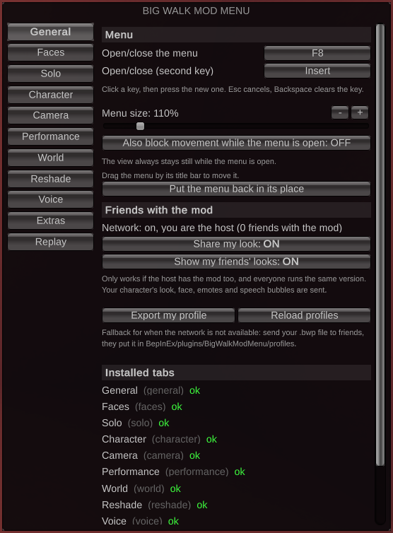</a><br><sub>General</sub></td>
<td align="center"><a href="docs/screenshots/faces.png">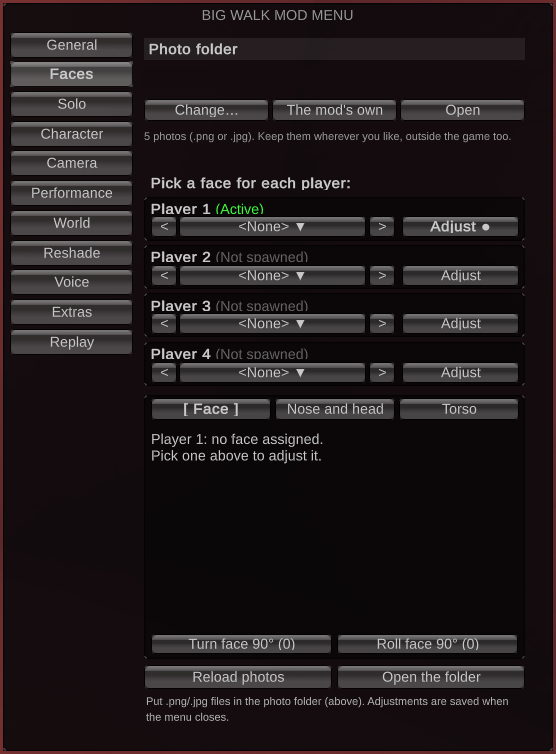</a><br><sub>Faces</sub></td>
<td align="center"><a href="docs/screenshots/solo.png">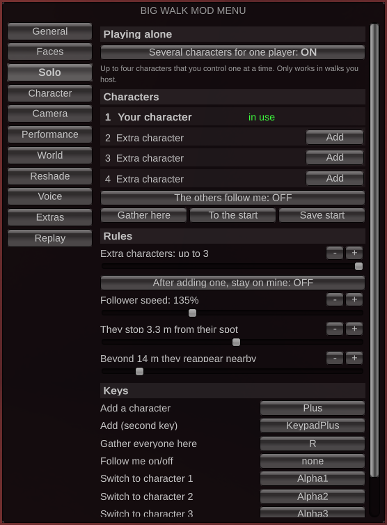</a><br><sub>Solo</sub></td>
<td align="center"><a href="docs/screenshots/character.png">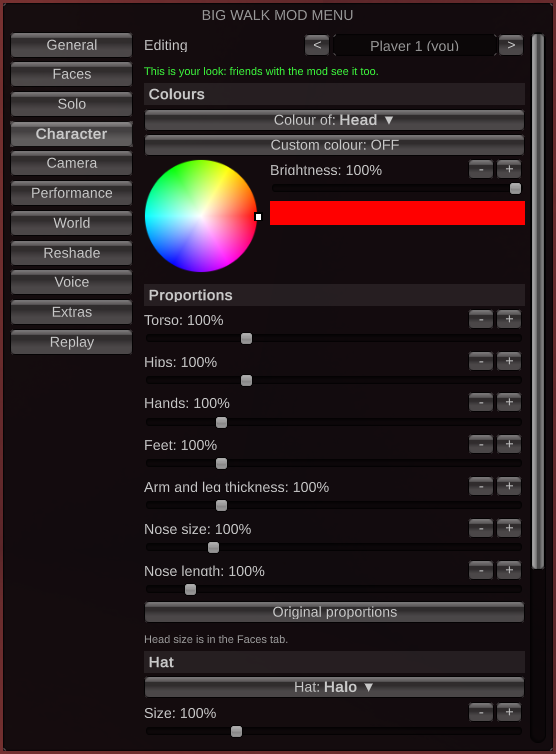</a><br><sub>Character</sub></td>
</tr>
<tr>
<td align="center"><a href="docs/screenshots/camera.png">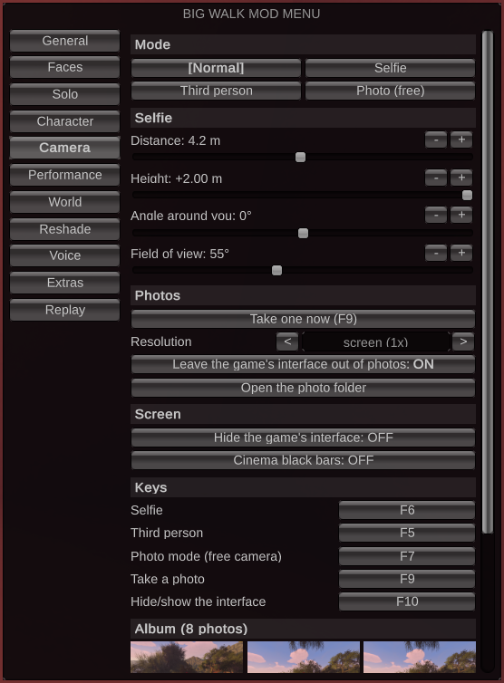</a><br><sub>Camera</sub></td>
<td align="center"><a href="docs/screenshots/performance.png">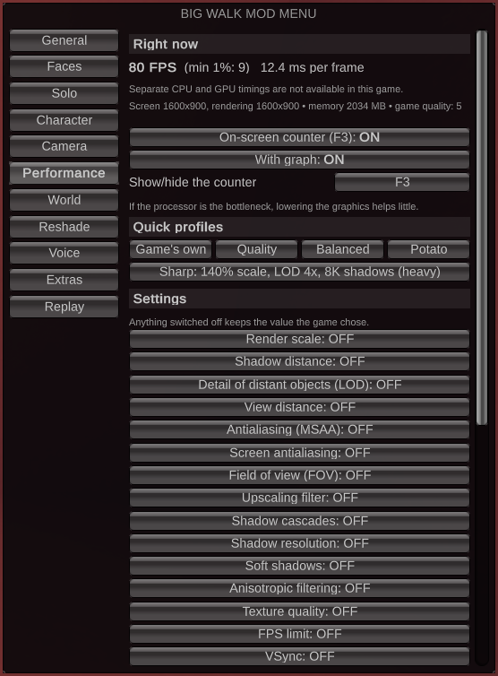</a><br><sub>Performance</sub></td>
<td align="center"><a href="docs/screenshots/world.png">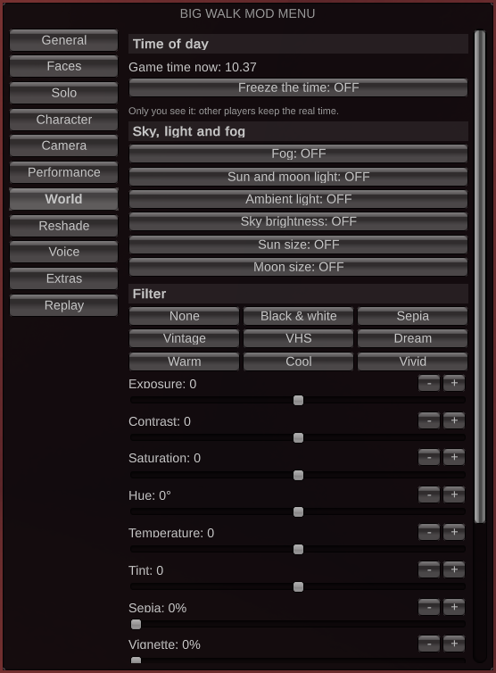</a><br><sub>World</sub></td>
<td align="center"><a href="docs/screenshots/reshade.png">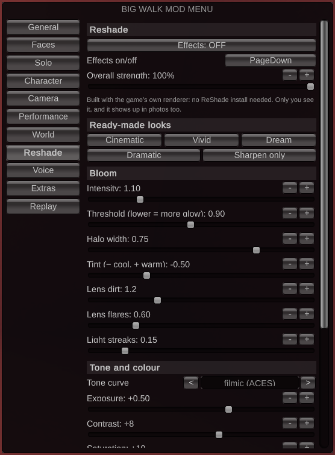</a><br><sub>Reshade</sub></td>
</tr>
<tr>
<td align="center"><a href="docs/screenshots/voice.png">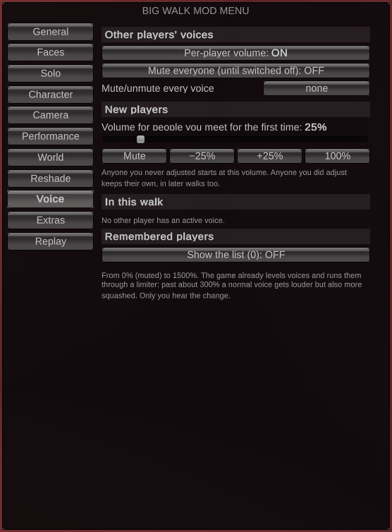</a><br><sub>Voice</sub></td>
<td align="center"><a href="docs/screenshots/extras.png">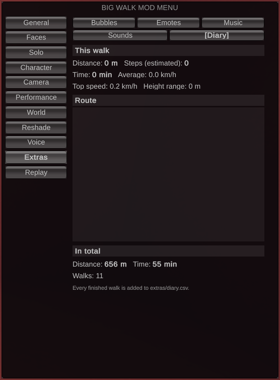</a><br><sub>Extras</sub></td>
<td align="center"><a href="docs/screenshots/replay.png">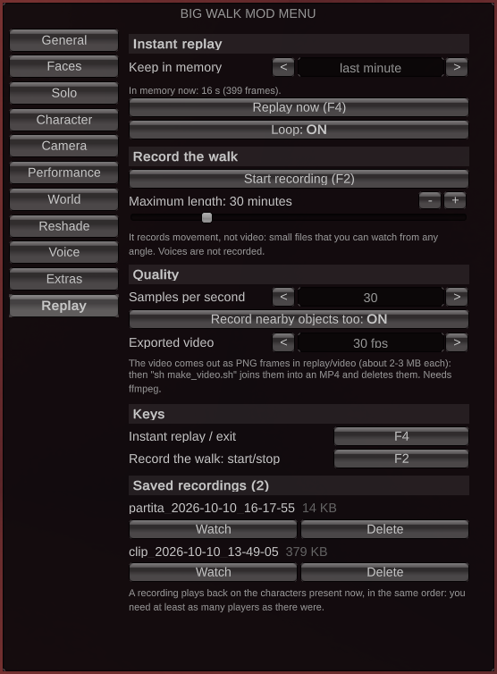</a><br><sub>Replay</sub></td>
</tr>
</table>

## The tabs

| Tab | What it does |
|---|---|
| **General** | The base menu, always installed: window, key bindings, menu size, sharing your look with friends who run the mod. |
| **Faces** | Put a photo on a character's head (and torso), with placement controls. Photos come from a folder you choose. Or your webcam, live. |
| **Solo** | Play alone with up to four characters: add, switch, remove, gather, follow. Host only. |
| **Character** | Hats, accessories, twenty head shapes (dice, creeper, pumpkin, television, ...), colours, proportions, light and trail. |
| **Camera** | Selfie, third person, free camera, screenshots up to 4x, hide the interface. |
| **Performance** | FPS counter, render scale 10–200%, FOV 45–150, antialiasing, shadows, LOD, per-system quality. |
| **World** | Fixed time of day (only you see it), sky, light and fog, colour filters. |
| **Reshade** | Bloom, lens dirt and flares, filmic tone curve, exposure, sharpening, ready-made looks. No ReShade needed. |
| **Voice** | Volume of each other player's voice, from mute to 1500%, remembered between sessions. |
| **Extras** | Music and sounds from your own files, emotes, speech bubbles. |
| **Replay** | Record a scene and play it back on the real characters; export frames for a video. |

## Install

Close the game, then paste one line in a terminal.

**Windows** (PowerShell):

```powershell
irm https://github.com/Giorey01/BigWalkModMenu/releases/latest/download/install.ps1 | iex
```

**Linux / Steam Deck**:

```bash
bash <(curl -fsSL https://github.com/Giorey01/BigWalkModMenu/releases/latest/download/install.sh)
```

On Linux, set this launch option for Big Walk in Steam once: `WINEDLLOVERRIDES="winhttp=n,b" %command%`.

The line downloads the latest release, checks its SHA-256 and runs the installer inside it. On Windows it
asks for administrator rights only if the game folder cannot be written without them. Both scripts are short
and readable: [`install.ps1`](dist/online/install.ps1), [`install.sh`](dist/online/install.sh).

<details>
<summary>Prefer to download it yourself?</summary>

1. Download `BigWalkModMenu-x.y.z.zip` from the [latest release](https://github.com/Giorey01/BigWalkModMenu/releases/latest) and extract all of it.
2. Close the game.
3. **Windows**: double-click `install-windows.bat`. **Linux / Steam Deck**: `bash install-linux.sh`.

</details>

The installer finds the game, installs BepInEx 6 (be.785) if it is missing, checking its SHA-256, and asks
which tabs you want. Run it again any time to update or add tabs; it never removes anything. The first start
after installing BepInEx takes a few minutes.

Installing by hand, updating from older versions, uninstalling and troubleshooting are covered in the
[package README](dist/pacchetto/README.md); what changed is in the [changelog](dist/pacchetto/CHANGELOG.md).

### Webcam on your head

Faces → **Webcam** → "Live webcam on my head", then "Open the page". The game cannot open a camera, so a page in
your browser does: it reads the camera, follows your face and hands the pictures to the mod on your own computer
(`127.0.0.1`, nothing else can reach it). Keep the page open and its window not minimised while you play.

- The switch is off at every start of the game, and the camera only runs during a walk. A banner at the top
  of the screen stays up while it is on.
- Friends in the walk who have this version of the mod (host included) see it, small and a few pictures a
  second. They could record it: only switch it on with people you trust.
- The page downloads its face tracking (MediaPipe, from jsdelivr.net and storage.googleapis.com) the first time,
  so it needs the internet. Your pictures are not sent there. Without it the page shows the middle of the picture.

### Multiplayer

- Voice, Reshade, Performance, World, Camera and Replay only change what you see and hear.
- Seeing each other's faces and looks needs the mod on every player, host included, same version.
- Solo needs you to be the host.
- Please do not report bugs to the game's developers while you are using mods.

## Build from source

You need the .NET SDK (6 or newer) and the game with BepInEx installed and started once: the projects
reference the DLLs BepInEx generates in the game folder.

```bash
bash build.sh             # builds everything, fills dist/pacchetto, makes dist/*.zip
GAME_DIR="/path/to/Big Walk" bash build.sh
```

On Windows run the same commands from Git Bash (it comes with Git for Windows): the script finds the game in
`C:\Program Files (x86)\Steam`, and for a game in another library `GAME_DIR="D:/SteamLibrary/steamapps/common/Big Walk"`
does it. The zips are made with `zip`, Python 3 or the `tar.exe` that Windows 10 and 11 include.

A single project: `dotnet build -c Release` in its folder (on Windows add `-p:GameDir="C:\path	o\Big Walk"`).
Adding `-p:Dev=1` to Core includes the in-game test bridge (`Core/Dev.cs`, driven by `tools/dev.sh`, or
`tools/dev.ps1` on Windows); never ship that build.

## Repository layout

```
BigWalkModMenu/
  Core/                  the menu: window, Ui, settings, key bindings, networking, General tab
  Faces/ Solo/ Character/ Camera/ Performance/ World/ Reshade/ Voice/ Extras/ Replay/
                         one project per tab
  Directory.Build.props  version, shared settings, references to the game
  MODLOG.md              project journal (in Italian): what was found, tested and not tested
docs/screenshots/        the pictures in this page
dist/pacchetto/          what ships: installers, README, changelog (DLLs are build output)
dist/online/             the one-line installers (build.sh fills in version and checksum)
tools/dev.sh             client of the in-game test bridge
build.sh                 build + package
.claude/skills/          the agent skills this mod was built with
CLAUDE.md                project notes for an AI agent or a new contributor
```

No personal photos, no game files and no decompiled game code are in this repository.

## Fork it and keep going

This mod was written with [Claude Code](https://claude.com/claude-code) working with the author, and the
repository carries what an agent needs to pick it up where it stopped:

- [`CLAUDE.md`](CLAUDE.md) — how to build, package and test, and the rules the code follows.
- [`.claude/skills`](.claude/skills) — the modding skills that were used (from
  [universal-modder](https://github.com/rehan-remade/universal-modder), MIT).
- [`BigWalkModMenu/MODLOG.md`](BigWalkModMenu/MODLOG.md) — every fact learned about the game and the state of
  each feature, including what has not been tested yet.

Open the folder in Claude Code and ask for the change you want; the skills and notes load on their own.

## Credits

- [BepInEx](https://github.com/BepInEx/BepInEx), HarmonyX and Il2CppInterop load and patch the game.
- NVorbis, NLayer, StbImageSharp, StbImageWriteSharp: see [`THIRD-PARTY-NOTICES.txt`](dist/pacchetto/THIRD-PARTY-NOTICES.txt).
- Ideas and feature lists came from these mods, whose features were rebuilt inside the menu: **Big Voice** and
  **Big Visuals** by glarmer, **Big Solo Walk / Big Walk Solo Player**, and the **Cinematic Reshade** preset.

## Licence

[MIT](LICENSE) for the code in this repository. The bundled libraries and skills keep their own licences
(see the notices above and `.claude/skills/LICENSE-universal-modder.txt`).

Big Walk and its logo belong to [House House](https://househou.se/). This is an unofficial fan project, not
affiliated with or endorsed by them; the logo above is loaded from the game's Steam page and is not part of
this repository.
